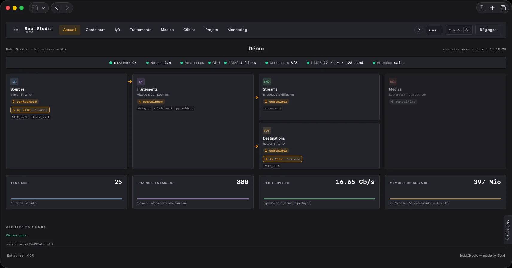
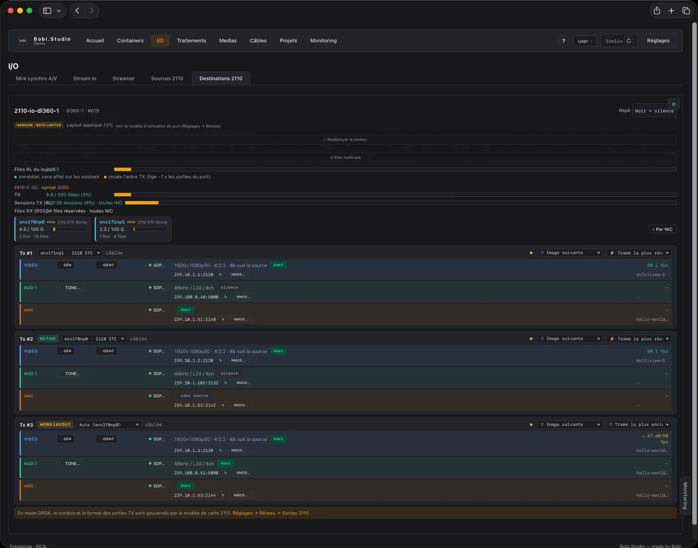

# Bobi.Studio

**A video production orchestrator running in Docker containers.** A complete control room —
camera inputs, mixer, multiview, audio console, recording, distribution — where every function
is a container, on commodity Debian servers. Free software, GNU GPL v3.

*[Version française](README.md)*

Everything is built around the **MXL bus**: the Media eXchange Layer that came out of the EBU's
work, the exchange layer its *Dynamic Media Facility Reference Architecture* calls for. Inside a
node, video and audio never go over the network: they travel **uncompressed** in shared memory.
The signal only enters and leaves at the edge of the chain, where **ST 2110**, **SRT**, **RTMP**
and **SDI** (DeckLink cards) coexist, source by source.



Four nodes, eight containers, 25 flows on the MXL bus and 16.65 Gb/s of pipeline in shared
memory.

## The bus, end to end

- **Inside a node** — one MXL domain per node (`/dev/shm/mxl`). A plugin reads and writes grains
  there: no network copy, no re-encoding between two functions. Each one works in frame
  **slices** and reports the share of the frame budget it consumes: the chain's latency is shown
  in milliseconds, link by link.
- **Between nodes** — the same bus extends through **`mxl-fabrics`**, the inter-host replication
  framework introduced in **MXL v1.1**, on top of libfabric. With the `verbs` provider this is
  **RDMA RoCEv2**: the card writes straight into the memory of the node opposite. What travels
  on the wire is still an MXL flow.
- **Outwards** — the bus is published as **NMOS** resources under the `urn:x-nmos:transport:mxl`
  transport, in line with **AMWA BCP-007-03**. A third-party controller sees the internal graph
  — mixer, multiview, player, recorder — the way it sees ST 2110 flows, and connects it the same
  way. That literal is mandated by the BCP but is not in the AMWA transport registry yet: a
  strict controller may refuse the resource for that reason. Published contract:
  [`docs/reference/NMOS_MXL.md`](docs/reference/NMOS_MXL.md).

So the bus is not a house format: a third-party product that implements MXL reads and writes the
same flows. The SDK is built from upstream, and interoperability is checked on the bench both
ways against an unpatched MXL —
[`docs/reference/MXL_INTEROP.md`](docs/reference/MXL_INTEROP.md).

## The model, in four pieces

| | |
|---|---|
| **A controller** | A web application that keeps the inventory, deploys the containers, knows what is cabled to what, and polls the fleet every 5 s. It runs no video processing. |
| **Nodes** | Enrolled Debian servers, each with its agent. They run the production: receive, composition, encoding, transmit. You add one with a single command. |
| **Logical cabling** | A container knows nothing of its neighbours, only the flows it consumes and the ones it produces. Changing a source means changing a connection — hot, with a converter inserted when the formats do not match. |
| **Plugins** | Every function is a versioned plugin running in its own container. It installs from a catalogue, with no repository to clone and nothing to touch in the core, and the authoring contract is public. |

Cabling, configuration and on-air state are rows in a database: a **project** is saved,
versioned, placed per node and replayed identically. Building a control room means loading a
project.

## What it speaks

- **Essences and transport** — MXL (the bus and `mxl-fabrics`), ST 2110-20/-30/-40, ST 2022-7,
  ST 2059 / PTP IEEE 1588, SAP/SDP (AES67, Ravenna), IGMPv3, SRT, RTMP, WHIP/WHEP, MPEG-TS,
  H.264, HEVC, AAC, Opus
- **Discovery and control** — AMWA NMOS **IS-04** (registration), **IS-05** (connection),
  **IS-07** (events and tally, incoming and outgoing), **IS-09** (system parameters),
  **IS-12** (WebSocket) and **IS-14** (REST) on top of the **MS-05-02** model, plus
  **BCP-002-01/02** (grouping, asset identity), **BCP-004-01** (receiver capabilities),
  **BCP-007-03** (the MXL bus as NMOS resources) and **BCP-008-01/02** (Rx and Tx health
  monitors)
- **Supervision and control surfaces** — Ember+, TSL UMD 5.0, read-only SNMPv3 with traps,
  Skaarhoj Raw Panel, ATEM panel emulation

**BCP-003-02** authorisation is **not yet** implemented — it is planned. No token is verified as
things stand: the control plane is assumed to be protected.



The `2110_io` engine receives and transmits straight from the network card without going through
the kernel (MTL/DPDK, AF-XDP). Each output carries its transmit class — narrow here, under a
rate limiter — its session description and its NMOS registration. The card is at 6.8 of the
200 Gb/s it aggregates.

## Try it

On a bare Debian 13 machine:

```bash
bash <(curl -fsSL https://raw.githubusercontent.com/bob-integration/bobistudio/main/get.sh)
```

`--liste` prints the published versions and stops, `--dry-run` fetches and verifies the source
without installing anything. The menu provisions the machine as **all-in-one** (controller plus
a local node) to look at the product on a single server, or as separate **controller** and
**nodes** for a cluster. The other installation paths are described further down, and in detail
in [INSTALL.md](INSTALL.md) (in French).

An SRT or RTMP chain from end to end runs on an ordinary server: no 2110 card, no PTP, no
multicast. Those three only come into play the day a node carries the ST 2110 engine
([INSTALL.md §5](INSTALL.md#5-préparation-dun-nœud-média-st-2110)).

> ## Before you use it
>
> The figures given here come from measurements on real hardware. An offline verification suite
> runs in CI on every push and blocks on failure, and what is not fixed is **written down** in
> `CHANGELOG.md` rather than left unsaid.
>
> - **Calibrate before you go on air.** At the "Dedicated" level a container is reserved whole
>   physical cores, whether it uses them or not: that is what makes its frame rate guaranteed,
>   and that is just as many cores taken away from the others. So the whole point is to reserve
>   the right amount. The profiles shipped by default were measured on the publisher's hardware;
>   on yours — another CPU generation, another memory frequency, another card — the same
>   container does not cost the same. Too low, the reservation throttles the container; too
>   high, it ties up cores for nothing and the node carries fewer functions than it could.
>   Nothing tells you, either way. Build your setup, exercise it at the worst it will ever do,
>   run a calibration campaign: that measurement, and nothing else, is what earns the word
>   "guaranteed".
>   Procedure: [INSTALL.md §9](INSTALL.md#9-avant-la-première-antenne--étalonner-sur-votre-matériel).
> - **Try it off air first.** This is a broadcast product: what breaks in it breaks live.
> - **The standards are implemented, and their updates tracked.** IS-05 is served in v1.2 and
>   v1.1, BCP-007-03 in v1.0.0; the detail, specification by specification — what is served, in
>   which version, in which file — is kept in the NMOS service's README. We follow the AMWA
>   publications and port what comes out.
> - **The plugin authoring contract is stable.** It grows by addition: the manifest gains
>   possibilities, it does not lose any, and the package format has not changed since September.
>   A plugin declares the core it needs (`requires.core_min`): installation refuses a plugin
>   that is too old instead of letting it break silently.
>
> Two kinds of feedback help us most: what blocks you during installation, and what the
> documentation fails to say. Please open an issue.

## What it does, in detail

### Producing the signal

The orchestrator runs none of what follows. Each of these functions is a **plugin**, in its own
container, on a node; the orchestrator deploys them, cables them and watches them, without ever
touching the media.

- **ST 2110 inputs and outputs** — receive and transmit in kernel-bypass (MTL/DPDK, AF-XDP), composable video, audio and ANC flows, narrow and wide transmit classes, native-field interlaced chain.
- **SDI inputs and outputs** — Blackmagic DeckLink cards, to get in and out of an installation that is not on IP.
- **Contribution** — SRT and RTMP ingest; simultaneous encoding to several UDP, SRT and WebRTC destinations, multi-track audio, WHEP preview.
- **Audio console** — mixing with AFV, tool memories, operator views, an LV2 effects library, MCU/HUI control surfaces; optional voice identification.

### Organising the production

- **Hot cabling** — graphical topology, live source switching, a converter inserted as a matter of course when the formats do not match.
- **Projects** — a project starts, stops, is versioned and is placed per node; a snapshot of the cabling and the configuration, recall with progress, per-user restricted access.
- **Virtual ports** — an input cabled to a port follows the physical flow assigned to it, without touching the project.
- **On-air state** — whatever was on air when it stopped is back on air when it starts.
- **Media** — a per-container library and a central registry, playlists, import from the computer, a "Keep here" lock, archival.

### Being driven from outside

Each control protocol is a **service** of the orchestrator: `nmos`, `emberplus`, `tsl`, `sap`,
`snmp`, `panel_atem`, `panel_skaarhoj`, `panel_dyvi`, `webrtc_gateway`. What they address, on
the other hand, belongs to the core: slots and macros are the same whatever protocol drives
them.

- **Production slots** — the *functional* identity of a production position, stable across container replacement: this is what third-party control systems address.
- **Macros and triggers** — chains of actions and continuous parameters; every plugin capability is drivable without going through the interface.
- **Control surfaces** — ATEM panel emulation, and Skaarhoj in its native protocol (named presets, XY routing).
- **Monitoring** — one WebRTC return feed per user, available from every page.

### Running a fleet

- **Multi-node** — enrolment in one command, bus replication between nodes through `mxl-fabrics` (RDMA RoCEv2), centralised multicast allocation, controller in warm-standby high availability ([HA.md](HA.md)).
- **Measured resources** — CPU profiles per container type, placement levels (including "Dedicated": whole physical cores), NUMA-aware allocation, calibration under real load and a check of the placement actually obtained. No allocation by guesswork.
- **Fleet health** — CPU, RAM, disk, sensors, PTP, GPU, RDMA and memory bandwidth per node; failed node detected, contextual alerts, e-mail notification.
- **Commissioning** — node installer, PXE/UEFI HTTP network boot or USB stick, iLO takeover; hardware drivers installed and updated by the agent.
- **Traceability** — container logs, an operations journal, an audit trail of user actions.
- **Release watch** — the orchestrator watches the published releases and tells the administrators. It never installs anything by itself.

### Extending

- **Plugins** — every function is a versioned plugin, deployed and updated independently of the core; the authoring contract is public and an example plugin gives you a base.
- **Catalogue** — the plugins and services published by a trusted GitHub organisation, compared with what is installed and installed in one click, with no repository to clone.
- **Interface** — French and English across the interface and the help, three control-room themes; any other language is added from the interface, without touching the code.

## Architecture, in code

- **Controller**: a Flask application (port 5000) plus a supervision thread. No production container runs on it (except in "all-in-one" mode).
- **Nodes**: enrolled Debian machines (`nodes` table), driven by `app/node_driver.py` through an HTTP **node agent** (`node_agent/agent.py`, per-node token) that handles the Docker lifecycle and host operations.
- **Containers**: created by `app/docker_driver.py` (ST 2110 MTL engine, dedicated AF-XDP NIC) and `app/docker_compute.py` (compute/media, **macvlan** network — one IP per container).

## Documentation

| Document | For whom |
|---|---|
| [`INFRASTRUCTURE.md`](INFRASTRUCTURE.md) | **Before buying**: CPU, RAM and memory-bandwidth choices, network cards, GPU, RDMA, PTP, the three network planes, redundancy |
| [`INSTALL.md`](INSTALL.md) | **Commissioning**: from bare machine to first flow, with the points that make an installation fail |
| [`NODE_AGENT.md`](NODE_AGENT.md) | The node agent's HTTP contract |
| [`HA.md`](HA.md) | Controller high availability (warm standby) |
| [`THIRD-PARTY-NOTICES.md`](THIRD-PARTY-NOTICES.md) | Third-party components and licences |

These documents are also rendered **inside the interface**, on the **Help** page — same source,
no copy to maintain. The online help additionally carries one section per plugin
(`plugins/<type>/help.md`). Several of these documents are in French only for now.

## Installation

The command given above, ["Try it"](#try-it), is the normal path: it lists the published
versions, fetches the source, then opens the installer's menu, which provisions the machine as a
**controller**, a **process node**, or **all-in-one**. The first administrator account is then
created in the browser: as long as no user exists, the controller leads to a wizard that creates
it and goes straight on to the settings that matter.

Everything else is in [INSTALL.md](INSTALL.md), from bare machine to first flow, with the points
that make an installation fail:

| | |
|---|---|
| [§2.1](INSTALL.md#21-installeur-unifié-recommandé) · [§2.2](INSTALL.md#22-installation-manuelle) | Installer from a package or a clone, manual installation, systemd service, uninstallation |
| [§4](INSTALL.md#4-enrôlement-dun-nœud) | Enrolling a node: direct, zero-touch, or without touching it (PXE / UEFI HTTP, USB, iLO) |
| [§5](INSTALL.md#5-préparation-dun-nœud-média-st-2110) | Preparing an ST 2110 media node: hugepages, DDP, queues, PTP |
| [§8.3](INSTALL.md#83-installation-sans-accès-internet-bundle-hors-ligne) | Installing without Internet access, from an offline package |
| [§9](INSTALL.md#9-avant-la-première-antenne--étalonner-sur-votre-matériel) | Calibrating on **your** hardware before the first broadcast |

INSTALL.md is in French for now.

### Day to day

```bash
systemctl {start|stop|restart|status} bobistudio
journalctl -u bobistudio -f    # live logs

./venv/bin/python main.py      # manual start, for development
```

## Configuration

Almost everything is set from the interface. Nodes, their address and their token are declared
under **Settings → Nodes**; the container network, ST 2110, NMOS, TSL, WebRTC, PTP, themes and
users live under **Settings**, and their values in the database.

On the file side all that is left are paths and constants, with no secret at all:

| File | Role |
|---|---|
| `app/config.py` | The defaults: database, logs, TLS directory, the catalogue's GitHub organisation, supervision interval |
| `config_local.py` | An override of those defaults, at the root, **not versioned**. Laid down by the installer, and empty by default — you only touch it to move a path, for instance the database onto an encrypted mount |

## Layout

```
main.py               ← Flask entry point (port 5000) + supervision thread
app/                  ← Python modules (deploy, plugins, node_driver, docker_driver, macros,
                        core_pool/placement, node_health, ptp, ha…) + app/routes/ (REST API)
plugins/              ← one plugin per container type (plugin.json + script.py + UI)
                        plus `_*_runtime` directories (shared Docker images, not plugins)
services/             ← orchestrator services — `ls services/` is authoritative
node_agent/           ← node agent (agent.py) + node installer (install-node.sh) + iso/
install/              ← unified installer (install.py) + legacy Proxmox flow
templates/            ← Jinja2 HTML views
static/               ← JS (scripts.js + js/), CSS (base.css, nav.css, themes), uploads/
i18n/                 ← translation catalogues (fr.json, en.json)
script_templates/     ← code that runs INSIDE the container: agent.py (per-container agent),
                        bobimxl.py (MXL SDK binding), C/CUDA kernels, benches
tests/                ← offline suite, no side effects — run as a block by CI
                        (.github/workflows/ci.yml), blocking on failure
tools/                ← utilities (create_admin.py, build_dist.py, ca-init.py…)
licenses/             ← full texts of third-party licences
docs/design/          ← DESIGN.md (UI guidelines and themes), PRODUCT.md (UX doctrine),
                        CONTEXT.md (business context)
docs/reference/       ← the documents that are authoritative on their subject
                        — `ls docs/reference/` is authoritative
docs/chantiers/       ← dated engineering journals (measurements, ports, decisions)
HA.md                 ← high availability (warm standby)
NODE_AGENT.md         ← node agent HTTP contract
CHANGELOG.md          ← version history (rendered on the Help page)
```

## Infrastructure prerequisites

- Controller: Debian 13 (trixie) with Python 3.13 (VM or dedicated machine)
- Nodes: Debian 13 (trixie) with Docker; for the `io2110` role, an Intel E810 or Mellanox ConnectX-4 to 7 NIC (MTL/DPDK, AF-XDP) plus hugepages and PTP — see `INFRASTRUCTURE.md`
- Network: a ST 2110 media plane, a macvlan segment for compute/media containers, and a control plane
- For WebRTC: the MediaMTX gateway is deployed from Settings → WebRTC

## Licence

Copyright (C) 2026 BOBI SAS, France
Author: Cyril Mazouer, on behalf of BOBI SAS.

Bobi.Studio is free software: you can redistribute it and/or modify it under the terms of the
**GNU General Public License version 3** as published by the Free Software Foundation, either
version 3 of the License, or (at your option) any later version.

This program is distributed in the hope that it will be useful, but WITHOUT ANY WARRANTY;
without even the implied warranty of MERCHANTABILITY or FITNESS FOR A PARTICULAR PURPOSE. See
the GNU General Public License for more details.

The full text is in the [`LICENSE`](LICENSE) file or at
<https://www.gnu.org/licenses/gpl-3.0.html>.

### Third-party components

Bobi.Studio integrates third-party components (MXL SDK, Intel Media Transport Library, DPDK,
FFmpeg, MediaMTX…) which remain subject to their own licences. The inventory, the copyright
notices to preserve and the points to watch are in
[`THIRD-PARTY-NOTICES.md`](THIRD-PARTY-NOTICES.md).

## Development

This project was developed with the assistance of Claude (Anthropic) as a code-generation tool,
under the direction and supervision of Cyril Mazouer.
