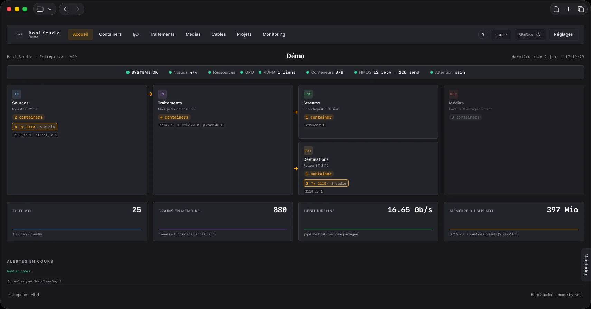
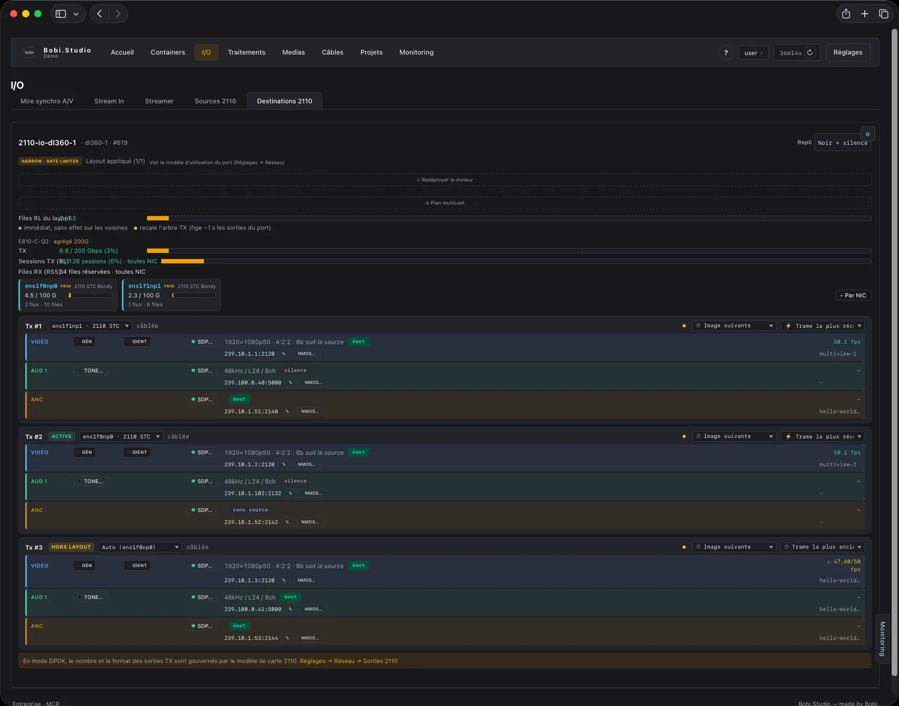

# Bobi.Studio

**Orchestrateur de production vidéo en conteneurs Docker.** Une régie complète — entrées
caméra, mélangeur, multiview, console audio, enregistrement, diffusion — où chaque fonction est
un conteneur, sur des serveurs Debian du commerce. Logiciel libre, GNU GPL v3.

*[English version](README.en.md)*

Tout est construit autour du **bus MXL** : la Media eXchange Layer issue des travaux de l'EBU,
la couche d'échange qu'appelle sa *Dynamic Media Facility Reference Architecture*. À
l'intérieur d'un nœud, la vidéo et l'audio ne passent pas par le réseau : ils circulent **non
compressés** en mémoire partagée. Le signal n'entre et ne sort qu'en bord de chaîne, où
**ST 2110**, **SRT**, **RTMP** et le **SDI** (cartes DeckLink) cohabitent, source par source.



Quatre nœuds, huit conteneurs, 25 flux sur le bus MXL et 16,65 Gb/s de pipeline en mémoire
partagée.

## Le bus, de bout en bout

- **Dans un nœud** — un domaine MXL par nœud (`/dev/shm/mxl`). Un plugin y lit et y écrit des
  grains : aucune copie réseau, aucun ré-encodage entre deux fonctions. Chacun travaille par
  **tranches** de trame et annonce la part du budget d'image qu'il consomme : la latence de la
  chaîne s'affiche en millisecondes, maillon par maillon.
- **Entre nœuds** — le même bus s'étend par **`mxl-fabrics`**, le framework de réplication
  inter-hôtes apparu dans **MXL v1.1**, au-dessus de libfabric. En provider `verbs`, c'est du
  **RDMA RoCEv2** : la carte écrit directement dans la mémoire du nœud d'en face. Ce qui voyage
  sur le fil reste un flux MXL.
- **Vers l'extérieur** — le bus est publié en ressources **NMOS** sous le transport
  `urn:x-nmos:transport:mxl`, conformément à **AMWA BCP-007-03**. Un contrôleur tiers voit le
  graphe interne — mélangeur, multiview, lecteur, enregistreur — comme il voit les flux
  ST 2110, et le connecte de la même façon. Ce littéral est imposé par la BCP mais n'est pas
  encore au registre AMWA des transports : un contrôleur strict peut refuser la ressource pour
  cette raison. Contrat publié :
  [`docs/reference/NMOS_MXL.md`](docs/reference/NMOS_MXL.md).

Le bus n'est donc pas un format maison : un produit tiers qui implémente MXL lit et écrit les
mêmes flux. Le SDK est buildé depuis l'amont, et l'interopérabilité vérifiée au banc dans les
deux sens contre un MXL non patché —
[`docs/reference/MXL_INTEROP.md`](docs/reference/MXL_INTEROP.md).

## Le modèle, en quatre pièces

| | |
|---|---|
| **Un contrôleur** | Une application web qui tient l'inventaire, déploie les conteneurs, sait ce qui est câblé à quoi et interroge le parc toutes les 5 s. Elle n'exécute aucun traitement vidéo. |
| **Des nœuds** | Des serveurs Debian enrôlés, chacun avec son agent. Ils exécutent la production : réception, composition, encodage, émission. On en ajoute un en une commande. |
| **Un câblage logique** | Un conteneur ne connaît pas ses voisins, seulement les flux qu'il consomme et ceux qu'il produit. Changer une source revient à changer un raccordement — à chaud, avec insertion d'un convertisseur quand les formats ne correspondent pas. |
| **Des plugins** | Chaque fonction est un plugin versionné qui tourne dans son propre conteneur. Il s'installe depuis un catalogue, sans cloner de dépôt ni toucher au cœur, et le contrat d'écriture est public. |

Le câblage, la configuration et l'état d'antenne sont des lignes en base : un **projet** se
sauvegarde, se versionne, se place par nœud et se rejoue à l'identique. Monter une régie, c'est
charger un projet.

## Ce qu'il parle

- **Essences et transport** — MXL (bus et `mxl-fabrics`), ST 2110-20/-30/-40, ST 2022-7, ST 2059 / PTP IEEE 1588,
  SAP/SDP (AES67, Ravenna), IGMPv3, SRT, RTMP, WHIP/WHEP, MPEG-TS, H.264, HEVC, AAC, Opus
- **Découverte et contrôle** — AMWA NMOS **IS-04** (enregistrement), **IS-05** (connexion),
  **IS-07** (événements et tally, entrant et sortant), **IS-09** (paramètres système),
  **IS-12** (WebSocket) et **IS-14** (REST) au-dessus du modèle **MS-05-02**, plus les
  **BCP-002-01/02** (grouping, identité d'asset), **BCP-004-01** (capacités de récepteur),
  **BCP-007-03** (le bus MXL en ressources NMOS) et **BCP-008-01/02** (moniteurs de santé des
  Rx et des Tx)
- **Supervision et pupitres** — Ember+, TSL UMD 5.0, SNMPv3 en lecture seule avec traps,
  Skaarhoj Raw Panel, émulation de pupitre ATEM

L'autorisation **BCP-003-02** n'est **pas encore** implémentée — elle est prévue. Aucun jeton
n'est vérifié à ce jour : le plan de contrôle est supposé protégé.



Le moteur `2110_io` reçoit et émet depuis la carte réseau sans traverser le noyau (MTL/DPDK,
AF-XDP). Chaque sortie porte sa classe d'émission — ici narrow, sous rate limiter —, sa
description de session et son enregistrement NMOS. La carte est à 6,8 des 200 Gb/s qu'elle
agrège.

## Essayer

Sur une machine Debian 13 vierge :

```bash
bash <(curl -fsSL https://raw.githubusercontent.com/bob-integration/bobistudio/main/get.sh)
```

`--liste` affiche les versions publiées et s'arrête, `--dry-run` récupère et vérifie la source
sans rien installer. Le menu provisionne la machine en **tout-en-un** (contrôleur + nœud local)
pour regarder le produit sur un seul serveur, ou en **contrôleur** et **nœuds** séparés pour un
cluster. Les autres chemins d'installation sont décrits plus bas, et en détail dans
[INSTALL.md](INSTALL.md).

Une chaîne SRT ou RTMP de bout en bout tourne sur un serveur ordinaire : ni carte 2110, ni
PTP, ni multicast. Ces trois-là n'entrent en jeu que le jour où un nœud porte le moteur
ST 2110 ([INSTALL.md §5](INSTALL.md#5-préparation-dun-nœud-média-st-2110)).

> ## Avant de vous en servir
>
> Les chiffres annoncés ici viennent de mesures sur du matériel réel. Une suite de
> vérifications hors ligne tourne en intégration continue à chaque poussée, de façon bloquante,
> et ce qui n'est pas corrigé est **écrit** dans `CHANGELOG.md` plutôt que passé sous silence.
>
> - **Étalonnez avant de passer à l'antenne.** Au niveau « Dédié », un conteneur se voit
>   réserver des cœurs physiques entiers, qu'il s'en serve ou non : c'est ce qui rend sa cadence
>   garantie, et c'est autant de cœurs retirés aux autres. Tout l'enjeu est donc de réserver
>   juste. Les profils livrés par défaut ont été mesurés sur le matériel de l'éditeur ; sur le
>   vôtre — autre génération de CPU, autre fréquence mémoire, autre carte — le même conteneur ne
>   coûte pas la même chose. Trop basse, la réservation bride le conteneur ; trop haute, elle
>   immobilise des cœurs pour rien et le nœud porte moins de fonctions qu'il ne pourrait. Rien
>   ne le signale, dans un cas comme dans l'autre. Montez votre dispositif, exercez-le au pire
>   de ce qu'il fera, lancez une campagne d'étalonnage : c'est cette mesure, et elle seule, qui
>   autorise le mot « garanti ».
>   Mode opératoire : [INSTALL.md §9](INSTALL.md#9-avant-la-première-antenne--étalonner-sur-votre-matériel).
> - **Éprouvez-le hors antenne d'abord.** C'est un produit de diffusion : ce qui s'y casse se
>   voit en direct.
> - **Les normes sont implémentées, et leurs mises à jour suivies.** IS-05 est servi en v1.2 et
>   en v1.1, BCP-007-03 en v1.0.0 ; le détail spécification par spécification — ce qui est
>   servi, dans quelle version, dans quel fichier — est tenu dans le README du service NMOS.
>   Nous suivons les publications de l'AMWA et portons ce qui sort.
> - **Le contrat d'écriture d'un plugin est stable.** Il grandit par ajouts : le manifeste gagne
>   des possibilités, il n'en perd pas, et le format de paquet n'a pas changé depuis septembre.
>   Un plugin déclare le cœur dont il a besoin (`requires.core_min`) : l'installation refuse un
>   plugin trop ancien au lieu de le laisser casser en silence.
>
> Deux retours nous sont particulièrement utiles : ce qui bloque à l'installation, et ce que la
> documentation ne dit pas. Ouvrez une issue.

## Ce qu'il fait, en détail

### Produire le signal

L'orchestrateur n'exécute rien de ce qui suit. Chacune de ces fonctions est un **plugin**, dans
son propre conteneur, sur un nœud ; l'orchestrateur les déploie, les câble et les surveille,
sans jamais toucher au média.

- **Entrées et sorties ST 2110** — réception et émission en kernel-bypass (MTL/DPDK, AF-XDP), flux composables vidéo, audio et ANC, classes d'émission narrow et wide, chaîne entrelacée champ-natif.
- **Entrées et sorties SDI** — cartes Blackmagic DeckLink, pour entrer et sortir d'une installation qui n'est pas en IP.
- **Contribution** — ingestion SRT et RTMP ; encodage simultané vers plusieurs destinations UDP, SRT et WebRTC, audio multi-pistes, prévisualisation WHEP.
- **Console audio** — mixage avec AFV, mémoires d'outils, vues d'opérateur, bibliothèque d'effets LV2, surfaces de contrôle MCU/HUI ; identification vocale optionnelle.

### Organiser la production

- **Câblage à chaud** — topologie graphique, bascule de source en direct, conversion insérée d'office quand les formats ne correspondent pas.
- **Projets** — un projet se démarre, s'arrête, se versionne et se place par nœud ; instantané du câblage et de la configuration, rappel avec progression, accès restreint par utilisateur.
- **Ports virtuels** — une entrée câblée sur un port suit le flux physique qu'on lui affecte, sans toucher au projet.
- **État d'antenne** — ce qui était à l'antenne à l'arrêt y revient au démarrage.
- **Médias** — bibliothèque par conteneur et registre central, playlists, import depuis l'ordinateur, verrou « Garder ici », archivage.

### Se faire piloter de l'extérieur

Chaque protocole de contrôle est un **service** de l'orchestrateur : `nmos`, `emberplus`,
`tsl`, `sap`, `snmp`, `panel_atem`, `panel_skaarhoj`, `panel_dyvi`, `webrtc_gateway`. Ce qu'ils adressent,
en revanche, appartient au cœur : les emplacements et les macros sont les mêmes quel que soit
le protocole qui les pilote.

- **Emplacements** — l'identité *fonctionnelle* d'une position de production, stable au remplacement du conteneur : c'est elle qu'adressent les systèmes de contrôle tiers.
- **Macros et déclencheurs** — enchaînements d'actions et de paramètres continus ; toute capacité d'un plugin est pilotable sans passer par l'interface.
- **Pupitres** — émulation de pupitre ATEM, et Skaarhoj en protocole natif (presets nommés, routage XY).
- **Monitoring** — un retour vidéo WebRTC par utilisateur, disponible depuis toutes les pages.

### Exploiter un parc

- **Multi-nœuds** — enrôlement en une commande, réplication du bus entre nœuds par `mxl-fabrics` (RDMA RoCEv2), allocation multicast centralisée, contrôleur en haute disponibilité warm-standby ([HA.md](HA.md)).
- **Ressources mesurées** — profils CPU par type de conteneur, niveaux de place (dont « Dédié » : des cœurs physiques entiers), allocation consciente du NUMA, étalonnage en charge réelle et constat du placement effectif. Pas d'allocation à l'estime.
- **Santé de la flotte** — CPU, RAM, disque, capteurs, PTP, GPU, RDMA et bande passante mémoire par nœud ; nœud tombé détecté, alertes contextualisées, notification par e-mail.
- **Mise en service** — installeur de nœud, démarrage réseau PXE/UEFI HTTP ou clé USB, prise en main iLO ; pilotes matériel posés et mis à jour par l'agent.
- **Traçabilité** — logs des conteneurs, journal d'exploitation, piste d'audit des actions utilisateurs.
- **Veille des versions** — l'orchestrateur surveille les versions publiées et prévient les administrateurs. Il n'installe jamais de lui-même.

### Étendre

- **Plugins** — chaque fonction est un plugin versionné, déployé et mis à jour indépendamment du cœur ; le contrat d'écriture est public et un plugin d'exemple en donne la base.
- **Catalogue** — les plugins et services publiés par une organisation GitHub de confiance, comparés à l'installé et installés en un clic, sans cloner de dépôt.
- **Interface** — français et anglais sur l'interface comme sur l'aide, trois thèmes de régie ; toute autre langue s'ajoute depuis l'interface, sans toucher au code.

## Architecture, côté code

- **Contrôleur** : application Flask (port 5000) + thread de surveillance. Aucun conteneur de production ne tourne dessus (sauf mode « tout-en-un »).
- **Nœuds** : machines Debian enrôlées (table `nodes`), pilotées par `app/node_driver.py` via un **agent-nœud** HTTP (`node_agent/agent.py`, token par nœud) qui gère le lifecycle Docker et les opérations hôte.
- **Conteneurs** : créés par `app/docker_driver.py` (moteur ST 2110 MTL, NIC dédiée AF-XDP) et `app/docker_compute.py` (compute/média, réseau **macvlan** — une IP par conteneur).

## Documentation

| Document | Pour qui |
|---|---|
| [`INFRASTRUCTURE.md`](INFRASTRUCTURE.md) | **Avant d'acheter** : choix CPU, RAM et bande passante mémoire, cartes réseau, GPU, RDMA, PTP, les trois plans réseau, redondance |
| [`INSTALL.md`](INSTALL.md) | **Mise en service** : de la machine nue au premier flux, avec les points d'attention qui font échouer une installation |
| [`NODE_AGENT.md`](NODE_AGENT.md) | Contrat HTTP de l'agent-nœud |
| [`HA.md`](HA.md) | Haute disponibilité du contrôleur (warm-standby) |
| [`THIRD-PARTY-NOTICES.md`](THIRD-PARTY-NOTICES.md) | Composants tiers et licences |

Ces documents sont aussi rendus **dans l'interface**, page **Aide** — même source, pas de copie
à maintenir. L'aide en ligne couvre en plus une rubrique par plugin (`plugins/<type>/help.md`).

## Installation

La commande donnée plus haut, [« Essayer »](#essayer), est le chemin normal : elle liste les
versions publiées, récupère la source, puis ouvre le menu de l'installeur, qui provisionne la
machine en **contrôleur**, en **nœud de process**, ou en **tout-en-un**. Le premier compte administrateur se crée ensuite
dans le navigateur : tant qu'aucun utilisateur n'existe, le contrôleur mène à un assistant qui
le crée et enchaîne sur les réglages indispensables.

Tout le reste est dans [INSTALL.md](INSTALL.md), de la machine nue au premier flux, avec les
points d'attention qui font échouer une installation :

| | |
|---|---|
| [§2.1](INSTALL.md#21-installeur-unifié-recommandé) · [§2.2](INSTALL.md#22-installation-manuelle) | Installeur depuis un paquet ou un clone, installation manuelle, service systemd, désinstallation |
| [§4](INSTALL.md#4-enrôlement-dun-nœud) | Enrôler un nœud : directe, zéro-touche, ou sans y toucher (PXE / UEFI HTTP, USB, iLO) |
| [§5](INSTALL.md#5-préparation-dun-nœud-média-st-2110) | Préparer un nœud média ST 2110 : hugepages, DDP, files, PTP |
| [§8.3](INSTALL.md#83-installation-sans-accès-internet-bundle-hors-ligne) | Installer sans accès Internet, depuis un paquet hors-ligne |
| [§9](INSTALL.md#9-avant-la-première-antenne--étalonner-sur-votre-matériel) | Étalonner sur **votre** matériel avant la première antenne |

### Au quotidien

```bash
systemctl {start|stop|restart|status} bobistudio
journalctl -u bobistudio -f    # logs en direct

./venv/bin/python main.py      # lancement manuel, pour le développement
```

## Configuration

Presque tout se règle dans l'interface. Les nœuds, leur adresse et leur jeton se déclarent
dans **Réglages → Nœuds** ; le réseau des conteneurs, le ST 2110, NMOS, TSL, WebRTC, PTP, les
thèmes et les utilisateurs vivent dans **Réglages**, et leurs valeurs en base.

Côté fichiers il ne reste que des chemins et des constantes, sans aucun secret :

| Fichier | Rôle |
|---|---|
| `app/config.py` | Les défauts : base de données, journaux, répertoire TLS, organisation GitHub du catalogue, période de surveillance |
| `config_local.py` | Surcharge de ces défauts, à la racine, **non versionné**. Posé par l'installeur, et vide par défaut — on n'y touche que pour déplacer un chemin, par exemple la base sur un montage chiffré |

## Structure

```
main.py               ← point d'entrée Flask (port 5000) + thread de surveillance
app/                  ← modules Python (deploy, plugins, node_driver, docker_driver, macros,
                        core_pool/placement, node_health, ptp, ha…) + app/routes/ (API REST)
plugins/              ← un plugin par type de container (plugin.json + script.py + UI)
                        + dossiers `_*_runtime` (images Docker partagées, pas des plugins)
services/             ← services de l'orchestrateur — `ls services/` fait foi
node_agent/           ← agent-nœud (agent.py) + installeur de nœud (install-node.sh) + iso/
install/              ← installeur unifié (install.py) + flux Proxmox hérité
templates/            ← vues HTML Jinja2
static/               ← JS (scripts.js + js/), CSS (base.css, nav.css, thèmes), uploads/
i18n/                 ← catalogues de traduction (fr.json, en.json)
script_templates/     ← code exécuté DANS le conteneur : agent.py (agent par-conteneur),
                        bobimxl.py (binding du SDK MXL), noyaux C/CUDA, bancs
tests/                ← suite hors ligne, sans effet de bord — exécutée en bloc par la CI
                        (.github/workflows/ci.yml), de façon bloquante
tools/                ← utilitaires (create_admin.py, build_dist.py, ca-init.py…)
licenses/             ← textes intégraux des licences tierces
docs/design/          ← DESIGN.md (charte UI et thèmes), PRODUCT.md (doctrine UX),
                        CONTEXT.md (contexte métier)
docs/reference/       ← documents qui font foi sur leur sujet — `ls docs/reference/` fait foi
docs/chantiers/       ← journaux de chantier datés (mesures, portages, décisions)
HA.md                 ← haute disponibilité (warm-standby)
NODE_AGENT.md         ← contrat HTTP de l'agent-nœud
CHANGELOG.md          ← historique des versions (rendu sur la page Aide)
```

## Prérequis infrastructure

- Contrôleur : Debian 13 (trixie) avec Python 3.13 (VM ou machine dédiée)
- Nœuds : Debian 13 (trixie) avec Docker ; pour le rôle `io2110`, NIC Intel E810 ou Mellanox ConnectX-4 à 7 (MTL/DPDK, AF-XDP) + hugepages + PTP — cf. `INFRASTRUCTURE.md`
- Réseau : un plan média ST 2110, un segment macvlan pour les conteneurs compute/média, un plan de contrôle
- Pour WebRTC : la passerelle MediaMTX se déploie depuis Réglages → WebRTC

## Licence

Copyright (C) 2026 BOBI SAS, France
Auteur : Cyril Mazouer, pour le compte de BOBI SAS.

Bobi.Studio est un logiciel libre : vous pouvez le redistribuer et/ou le modifier
selon les termes de la **GNU General Public License version 3** telle que publiée par
la Free Software Foundation, soit la version 3 de la licence, soit (à votre choix)
toute version ultérieure.

Ce programme est distribué dans l'espoir qu'il sera utile, mais SANS AUCUNE GARANTIE ;
sans même la garantie implicite de QUALITÉ MARCHANDE ou d'ADÉQUATION À UN USAGE
PARTICULIER. Voir la GNU General Public License pour plus de détails.

Le texte complet est dans le fichier [`LICENSE`](LICENSE) ou sur
<https://www.gnu.org/licenses/gpl-3.0.html>.

### Composants tiers

Bobi.Studio intègre des composants tiers (SDK MXL, Intel Media Transport Library, DPDK,
FFmpeg, MediaMTX…) qui restent soumis à leur propre licence. L'inventaire, les mentions de
copyright à conserver et les points de vigilance sont dans
[`THIRD-PARTY-NOTICES.md`](THIRD-PARTY-NOTICES.md).

## Développement

Ce projet a été développé avec l'assistance de Claude (Anthropic)
comme outil de génération de code, sous la direction et supervision
de Cyril Mazouer.
